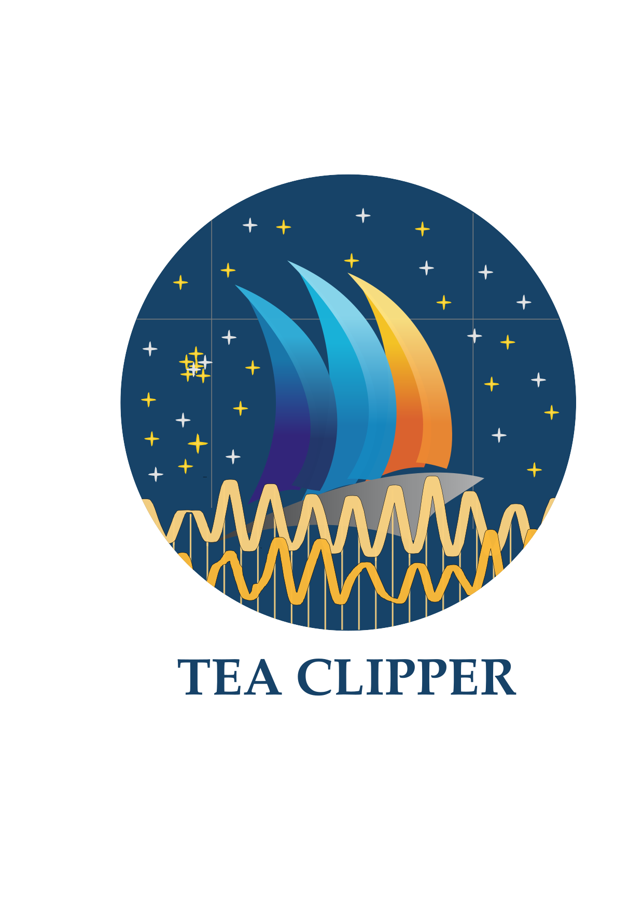
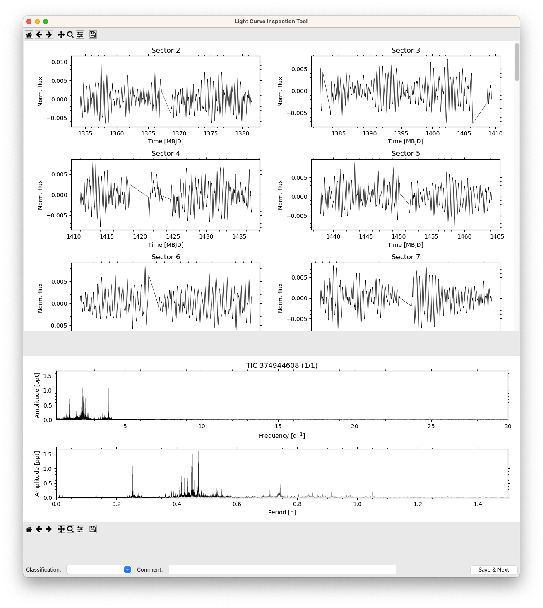
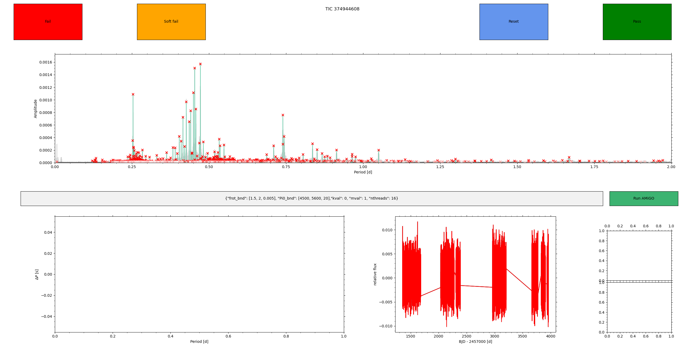
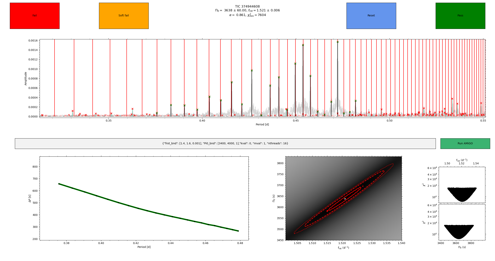

Tea clipper: TEss Asteroseismic Combined LIght curve Pipeline for PERiod spacings
================================================================
<p align="center">

</p>

Author: Dario Fritzewski (dario.fritzewski@kuleuven.be)

Tea Clipper is a Python package combining various Python packages developed by the asteroseismology group at the Institute of Astronomy (IvS) at KU Leuven. Its main purpose is to enable a smooth workflow for gravity mode asteroseismology by providing a unified interface to three main packages:
1. `tessutils` for obtaining light curves from TESS full-frame images (https://github.com/IvS-Asteroseismology/tessutils)
2. `star shadow` as the pre-whitening code (https://github.com/IvS-Asteroseismology/star_shadow)
3. `AMiGO` for fitting detected period-spacing patterns (https://github.com/IvS-Asteroseismology/amigo)

In addition, to the unifying the I/O processes of these packages, Tea Clipper offers two GUIs for light curve analysis and period spacing pattern identification and fitting. Below, an example workflow for *one* star is outlined. The package is meant to facilitate the asteroseismic analysis of multiple stars at the same time by allowing batch processing of TIC IDs. Both GUIs support the analysis and classification of many stars without exciting the main window.

Workflow
------------
To search for period-spacing patterns with TESS, we need stars with many observed TESS sectors. Ideal stars are located in the TESS continuous viewing zones. For this example, we choose TIC 374944608 from [Garcia et al (2022)](https://ui.adsabs.harvard.edu/abs/2022A%26A...662A..82G/abstract). Note that due to the amount of observed data, downloading and reducing the entire light curve may take some time and is quite resource intensive. Another star with a shorter period spacing pattern but also fewer observed Sectors is the Pleiad TIC 67828699 [(Fritzewski et al., 2026)](https://ui.adsabs.harvard.edu/abs/2026A%26A...706A.131F/abstract).

1. Download the TESS data and create light curve

```
from teaclipper import TUcluster
TICs = [374944608]
TUcluster.run_tu(TICs)
```

After completion a new folder called `TU` can be found in the current directory. It contains the light curve and other intermediate products. `TUcluster` exposes many `tessutils` keyword arguments to the user. For a full documentation of these `tessutils` capabilities please consult its [github page](https://github.com/IvS-Asteroseismology/tessutils).

2. To inspect the light curve beyond the diagnosis plot produced by `tessutils` (which should always be consult to check, for example, the contamination), we use the graphical user interface "Light Curve Inspection Tool":

```
from teaclipper import LCcheckGUI
LCcheckGUI.launch_lc_review_gui(TICs, version='TU')
```

A `tk` python window, as shown below, should appear. At the top, it shows all the light curves per Sector. Scroll down to see all light curves. The tool bar at the top allows the user to interact with the light curve plots. In the bottom part, the periodogram is shown both in frequency and period space, to facilitate the asteroseismic analysis. Similarly to the light curves the tool bar at the bottom allows for interaction with these plots.



3. Even after the detrending with the principal component analysis in `tessutils`, some trends can persist that can optionally be remove with polynomial detrending. 

```
from teaclipper import detrendLCs
detrendLCs.all_poly_detrend(TICs)
```

4. After detrending the light curves can be inspected again. In case of multiple stars, it would now be time to sort the light curves according to their asteroseismic potential. At the very bottom a drop down menu allows to select a category (or add a custom one) and add a comment for each TIC. The results are saved to a csv file for easy filtering. 

```
LCcheckGUI.launch_lc_review_gui(TICs, red_name=red_name, reviewfile='review_results_detrended.csv')
```

5. Now its time to extract all asteroseismicly relevant frequencies by pre-whitening with `starshadow`:
```
from teaclipper import prewhitenSTS
prewhitenSTS.prewhiten_all(TICs, red_name=red_name)
```

This runs `starshadow` and creates all relevant files in the folder `STS`. Note that depending on the number of data points this step might take a while.

6. Finally, we can extract the gravity mode period spacing pattern and analyse it with `AMiGO`.

```
from teaclipper import findPatterns
findPatterns.analyse_all(TICs, red_name=red_name)
``` 

Now an interactive `matplotlib` window appears that allows  to explore and fit the period spacing pattern.



The main plot shows the periodogram including the pre-whitened frequencies (red crosses). By clicking on them they can be selected (and turn green). Once more than one frequency is selected the bottom left plot shows the period spacing pattern. Right click allows to add gaps in the pattern. After selecting the detected pattern, the `AMiGO` parameters in the text box can be adjusted. By clicking "Run AMiGO" the fitting routine is initiated. Once a good fit is achieved (or not), the pass (fail) button at the top allow to go the next star in `TICs`. For the initial parameters, it is recommended to scan a wider range with a coarse resolution first. Once a solution is found, the parameters can be adjusted to bracket the observed values and increase the resolution to achieve the best possible fit.



This workflow is also outlined in `example.py`.

Installation instructions
------------------------------

Tea clipper needs a running installation of `tessutils`, `starshadow`, and `AMiGO`, in addition it requires `tk`. The `requirements.txt` includes all packages required to run tea clipper and `tessutils`, `starshadow`, and `AMiGO`. Alternatively, `teaclipper.yml` can be used to setup a conda environment, however, it might be slow. For problems with installing any of the other IvS packages please consult their respective github pages.

Be aware that installing *all* packages from the `conda-forge` channel might lead to problems with `tk`. Hence, it is recommended to have `default` as your higher priority channel to install all packages available on `default` installed through this channel. In particular, use `default` for `python`, `matplotlib`, and `tk`.
